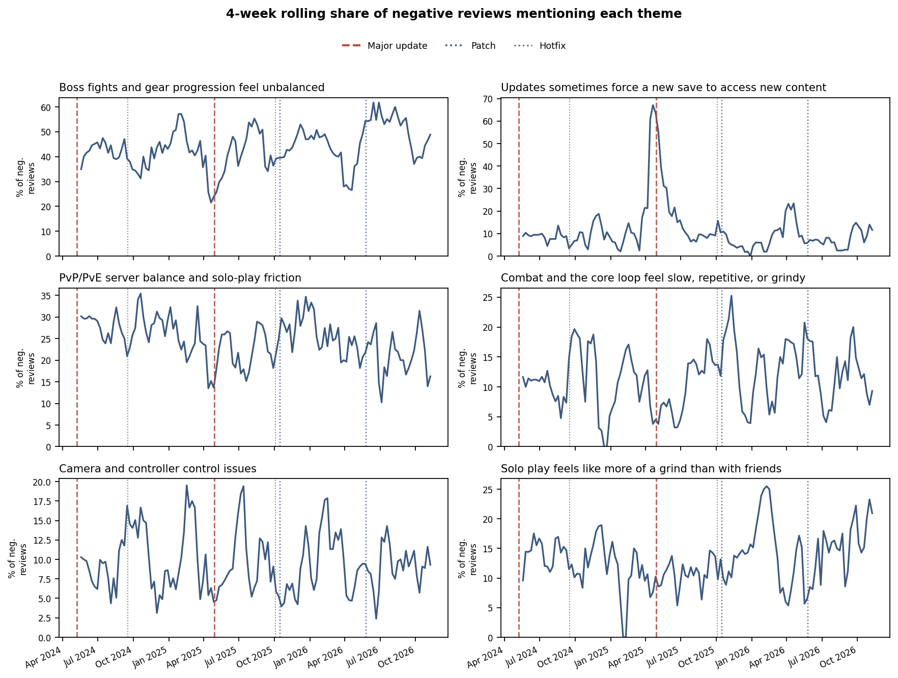
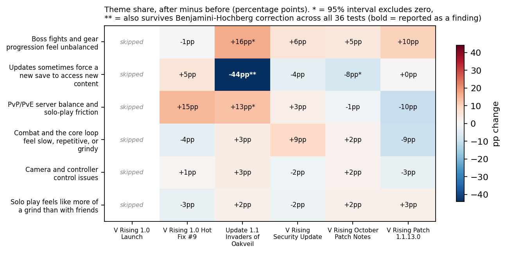

# V Rising: Public Steam Review Analysis

A small, honest portfolio analysis of public Steam reviews for *V Rising*
(Steam app id `1604030`). Built as a thesis-application portfolio piece, not
an official or endorsed analysis.

**This project uses only public data and is not affiliated with, endorsed
by, or produced in cooperation with Stunlock Studios.** All review text
belongs to the Steam users who wrote it; it is used here transiently (not
redistributed) for aggregate, anonymized analysis.

## What this is

- Review volume and 4-week rolling % positive, by week, with the two major
  content updates marked (1.0 Launch, 8 May 2024; Invaders of Oakveil,
  28 Apr 2025) plus three other verified volume spikes (see below)
- Recurring topics in negative reviews via TF-IDF + NMF, with short,
  clean representative phrases per topic (not full quotes, no profanity)
- How playtime-at-review differs between positive and negative reviews
- Whether each of those six negative-review themes rises or falls around
  specific, officially-verified V Rising patches (see
  [Theme trends by patch](#theme-trends-by-patch) below)

See `notebook/analysis.ipynb` for the full analysis and
`V_Rising_Review_Analysis_Summary.pdf` (2 pages) for a summary.

### Unlabeled vs. labeled volume spikes

Only volume spikes we could verify against an external source (Steam news,
patch-note trackers) are labeled on the chart:

| Event | Date | Source |
|---|---|---|
| 1.0.9.0 patch (Spells Balance, QoL, Gamepad) | 17 Sep 2024 | patch-note trackers |
| Steam Autumn Sale (platform-wide) | 27 Nov - 4 Dec 2024 | Steam sale calendar |
| Free Weekend + 1.1.1 patch | 14-18 May 2026 | patch-note trackers |

Everything else in the chart is left unlabeled rather than guessed at.

## Theme trends by patch

Goal: show whether each of the six negative-review themes (page 1) rises or
falls after specific V Rising updates, in a way a live team could read as
patch feedback.

**Patch timeline.** `data/patch_events.csv` lists only officially-sourced
events, every row with a working source URL from Steam's own news feed for
app 1604030 (`ISteamNews/GetNewsForApp`), fetched and verified directly, not
guessed:

| Date | Event | Type |
|---|---|---|
| 2024-05-08 | V Rising 1.0 Launch | major |
| 2024-09-17 | V Rising 1.0 Hot Fix #9 | hotfix |
| 2025-04-28 | Update 1.1 Invaders of Oakveil | major |
| 2025-10-03 | V Rising Security Update | hotfix |
| 2025-10-15 | V Rising October Patch Notes | patch |
| 2026-05-26 | V Rising Patch 1.1.13.0 | patch |

(Source URLs are in the CSV itself.) V Rising ships hotfixes far more often
than this; dozens of minor "Hot Fix N.M" posts cluster within days of a
major update and of each other. Those are deliberately **not** listed
individually here, since their own before/after windows would overlap with
a neighboring event's and make attribution meaningless; the six above are
the ones verifiable *and* far enough from another listed event for a clean
4-week window on at least one side.

**Theme assignment.** Reuses the exact TF-IDF + NMF model from page 1 (same
vectorizer settings, same `random_state`, not refit). Each negative review's
six NMF weights are row-normalized (divided by their sum); a theme is
assigned when its normalized weight is >= 0.3, so a review can carry zero,
one, or more themes. Of **2,860 negative reviews, 271 (9.5%) get no theme**
at all (mostly reviews too short to enter the model's vocabulary). A manual
spot check of 20 reviews assigned "forced new save" around Invaders of
Oakveil (10 from the before window, 10 from the after window) found roughly
8-9 out of 10 in each window genuinely discuss a save wipe or having to
start over; the rest are plausible but weaker fits. That's a normal noise
level for an unsupervised method at this threshold, not a labeling failure.

**Before/after per event.** For each event, a 4-week window immediately
before is compared to a 4-week window starting a week after (the release
week itself is skipped, since that's when reaction is freshest and most
mixed with launch-hype or sale noise). The metric is each theme's share of
*all* negative reviews in that window (not just modeled ones: reviews too
short to model count as not mentioning anything). Any window with fewer
than 30 negative reviews is skipped outright. Each share gets a 95% Wilson
interval; the before-after difference gets a 95% normal-approximation
interval, with a two-sided p-value for the correction below.

**A shift is reported as a finding only if it survives all four checks:**

1. The 95% interval on the before/after difference excludes zero.
2. **Benjamini-Hochberg correction** at a 5% false discovery rate, applied
   across all 30 event-theme pairs with enough data to test (not just the
   ones that happen to look interesting).
3. **A raw-weight robustness check:** the same comparison redone with theme
   assignment from *raw, unnormalized* NMF weights (threshold recalibrated
   to assign a comparable overall share of reviews) instead of the
   row-normalized ones used above.
4. **An all-reviews robustness check:** the same comparison redone with
   each theme's share measured against *all* reviews in the window
   (positive and negative), not negative reviews only.

Checks 3 and 4 exist because row-normalizing six weights that must sum to 1
has a side effect: if one theme's weight collapses for a group of reviews,
the other five mechanically look larger in share terms for those same
reviews, with no real independent change in them. That's a well-known
problem in compositional data analysis ("closure"), and it turned out to
matter here (see finding 2 below).

*Sensitivity check:* the before/after comparison (step 1 only) was also
re-run with 2-week and 8-week windows instead of 4. The significance call
flips for 3 of the 36 event-theme pairs tested this way; none of those
three are among the findings below.





**Findings:**

1. **The one shift that survives every check:** around Invaders of Oakveil,
   complaints about being forced into a new save to access new content
   dropped from 63.6% of negative reviews (n=88) to 19.5% (n=251), a
   **-44.1pp** change (95% CI -55.3 to -32.9pp, p < 0.001). It holds up
   using raw NMF weights instead of normalized ones (-40.6pp, CI -51.7 to
   -29.5pp) and measured against all reviews rather than negative reviews
   only (-7.9 percentage points of all reviews, CI -10.5 to -5.4pp), and
   survives Benjamini-Hochberg correction. People complained about the save
   wipe mostly *before* it happened, not after.
2. **Two shifts initially looked significant but did not survive the full
   check, and are retracted as findings.** "Boss fights and gear
   progression feel unbalanced" rose +16.4pp on the original 95% interval
   (CI +5.6 to +27.2pp), and "PvP/PvE server balance and solo-play
   friction" rose +13.1pp (CI +4.0 to +22.1pp), both around Invaders of
   Oakveil. Both shrink to non-significant under the raw-weight check
   (+5.5pp, CI -6.6 to +17.6pp; and -0.7pp, CI -12.6 to +11.1pp) and under
   the all-reviews check, and neither survives Benjamini-Hochberg
   correction. This is the normalization side effect described above: as
   the dominant "forced new save" share collapsed, these two rose
   mechanically in normalized-share terms without an independent signal
   behind them. A third shift, the October 2025 patch's "forced new save"
   dip (originally -7.9pp, CI -15.8 to -0.0pp), also does not survive
   Benjamini-Hochberg correction (p = 0.046 against a required p <= 0.007
   at its rank) and is likewise not reported as a finding.
3. Out of 30 event-theme pairs with enough data to test, only the one
   finding above holds up end to end. Everything else, including every
   theme around both hotfix-type events, the October 2025 patch, and Patch
   1.1.13.0, does not move in a way this method can tell apart from noise
   once corrected for multiple testing. **If a theme doesn't move, that's
   the honest result, not a gap in the analysis.**
4. "Camera and controller control issues" and "Solo play feels like more of
   a grind than with friends" never show a significant shift around any
   verified event tested here, at any window width: a stable background
   complaint rather than something that responds to a specific patch.

**This is correlation keyed to release dates, not a causal test.** Even the
one confirmed shift above is not proof the patch caused it. Free
weekends, platform-wide Steam sales, and influencer/content-creator waves
can land in the same before/after windows (see the volume chart above) and
are not separated out here. An observed shift may partly reflect one of
those instead of the patch itself; a shift that *doesn't* appear is more
trustworthy evidence of "nothing changed" than a shift that does appear is
evidence of "the patch caused this."

## What this explicitly is not

- Not a representative survey of the playerbase: Steam reviewers are a
  self-selected, vocal subset.
- English-language reviews only.
- Review text is stated opinion at a point in time, not behavioral
  telemetry. It can't show silent churn, actual session structure, or
  drop-off points the way internal analytics could.

No numbers in this repo are estimated or invented: everything is computed
directly from the fetched dataset, and the fetch/analysis code is included
so every number is reproducible.

## Data

Reviews are fetched directly from Steam's own storefront (no login, no API
key, no scraping of private data) via `scripts/fetch_reviews.py`. Only
review text, recommended/not, timestamp, playtime at time of review, and
vote counts are kept, no usernames, SteamIDs, or other author identifiers.

**On the endpoint:** Steam's documented public endpoint
(`store.steampowered.com/appreviews/<id>?json=1`) was re-tested directly
for this revision (cold, with a warmed session cookie, and with a
matching Referer header), and it still 302-redirects to the store
homepage for every app ID tried, not just this one. It appears to be
retired. `fetch_reviews.py` instead calls `/ajaxappreviews/<id>`, the
endpoint V Rising's own store page itself calls to render its review
widget (confirmed by inspecting that page's own network requests): same
storefront host, same public data, just the endpoint Valve's frontend
code actually uses today. See the docstring in that file for detail.

Raw review data is **not committed to this repo** (see `.gitignore`) since
it's third-party user-generated content pulled live from Steam, not
something to redistribute wholesale. Regenerate it locally:

```bash
pip install -r requirements.txt
cd scripts
python fetch_reviews.py --max-reviews 25000 --out ../data/reviews_raw.jsonl
```

This respects rate limits (a configurable sleep between paginated requests,
default 1.5s) and paginates via Steam's cursor mechanism.

## Reproducing the analysis

```bash
cd scripts
python build_notebook.py        # (re)generates notebook/analysis.ipynb
jupyter notebook ../notebook/analysis.ipynb
python make_theme_trends.py     # builds the theme-trends-by-patch charts
python make_pdf_summary.py      # regenerates the 2-page PDF + images/
```

`make_pdf_summary.py` embeds the charts `make_theme_trends.py` produces, so
run that first if you've changed the data or the patch timeline.

## Repo structure

```
scripts/
  fetch_reviews.py      # pulls reviews from Steam, strips to needed fields
  analysis.py           # shared analysis functions (volume, topics, playtime,
                         # theme assignment, before/after window analysis)
  build_notebook.py      # generates the notebook programmatically
  make_theme_trends.py   # builds the theme-trends-by-patch charts
  make_pdf_summary.py    # builds the 2-page PDF summary
notebook/
  analysis.ipynb         # the full walkthrough
images/                  # chart PNGs used in the notebook and PDF
data/
  patch_events.csv       # committed: small, hand-curated, officially-sourced
  reviews_raw.jsonl      # raw review data (gitignored, regenerate locally)
```
